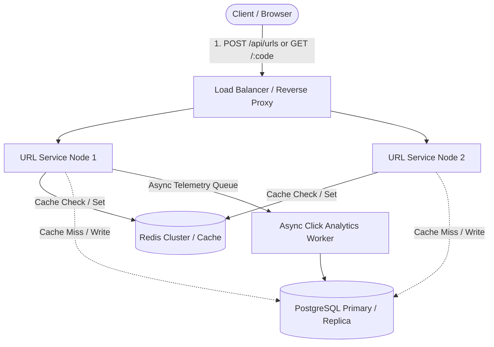

# System Design Architecture: Scalable URL Shortener

This document details the system design, capacity estimations, encoding algorithms, caching mechanics, and design trade-offs for the URL Shortener service.

---

## 1. High-Level Architecture Diagram

---

## 2. Capacity Estimations (Back-of-the-Envelope Calculations)

### Assumptions
- **Retention Period**: 5 Years ($157,788,000$ seconds)
- **Write QPS (New URLs created)**: 100 new URLs/sec
- **Read QPS (Redirections)**: 1,000 requests/sec (10:1 Read to Write ratio)

### Calculations:
1. **Total URLs stored across 5 years**:
   $$\text{Total URLs} = 100\text{ writes/sec} \times 86,400\text{ sec/day} \times 365.25\text{ days/year} \times 5\text{ years} \approx 15.78\text{ Billion URLs}$$

2. **Storage per URL Record**:
   - `id`: 8 bytes (BIGINT)
   - `short_code`: 7 bytes (VARCHAR)
   - `original_url`: 500 bytes (average)
   - `created_at`: 8 bytes (TIMESTAMP)
   - `expires_at`: 8 bytes (TIMESTAMP)
   - `click_count`: 8 bytes (BIGINT)
   - Indexes overhead: ~150 bytes
   - **Total per record**: $\approx 689\text{ bytes} \approx 0.7\text{ KB}$

3. **Total Persistent Storage Required (5 Years)**:
   $$15.78\text{ Billion URLs} \times 0.7\text{ KB} \approx 11\text{ TB}$$
   Easily manageable with PostgreSQL table partitioning (e.g., partition by `created_at` or `expires_at` year/month).

4. **Redis Cache Sizing (80-20 Rule)**:
   - 20% of URLs generate 80% of traffic.
   - Active daily hot URLs: $100\text{ writes/sec} \times 86,400\text{ sec} = 8.64\text{ Million URLs/day}$.
   - Hot cache working set for 1 day:
     $$8.64\text{ Million} \times 0.7\text{ KB} \approx 6.05\text{ GB RAM}$$
   - Provisioning a 32 GB or 64 GB Redis cluster comfortably retains the hot set using the `allkeys-lru` eviction policy.

---

## 3. Base62 vs. Hashing Strategies

### Why Base62 Counter vs. MD5/SHA-256?

| Approach | Mechanism | Collision Risk | Code Length | Computational Cost |
| :--- | :--- | :--- | :--- | :--- |
| **MD5 / SHA-256 Truncation** | Hash URL $\to$ take first 7 chars | High (Birthday paradox at scale) | 7 chars | High (Hashing + DB collision retries) |
| **Distributed Counter + Base62 (Chosen)** | Atomic Sequence ID $\to$ Base62 encode | **Zero (Mathematically guaranteed unique)** | Deterministic (6-7 chars) | Ultra low ($O(1)$ arithmetic) |

### Base62 Math
- Alphabet: `[0-9a-zA-Z]` (62 symbols)
- 6 characters: $62^6 \approx 56.8$ Billion distinct combinations
- 7 characters: $62^7 \approx 3.52$ Trillion distinct combinations
- With 15.78 billion URLs across 5 years, 6 to 7 alphanumeric characters provide plenty of headroom.

---

## 4. HTTP Redirection: Why 302 vs 301?

- **HTTP 301 (Moved Permanently)**:
  - Browsers cache the response in their internal cache indefinitely.
  - Subsequent requests never hit the URL shortener server.
  - **Downside**: Prevents real-time click tracking, geolocation analytics, and immediate URL revocation/expiration.
- **HTTP 302 (Found / Temporary Redirect - Selected)**:
  - Browser executes the redirect immediately without caching the mapping on client disks.
  - Every redirect request reaches the URL shortener (or Redis edge cache), ensuring accurate 5-year analytics and active expiration enforcement.

---

## 5. 5-Year Expiration Lifecycle

1. **Storage Phase**:
   - `expires_at` is set to `NOW() + 5 years`.
   - Redis cache key has TTL = `157,788,000` seconds.
2. **Read Phase**:
   - If accessed after expiration date, the service removes the Redis cache entry and returns `HTTP 410 Gone`.
3. **Archival Phase**:
   - A scheduled cleanup job or database partitioning scheme drops or archives partitions where `expires_at < NOW()`, reclaiming disk space without locking active tables.
